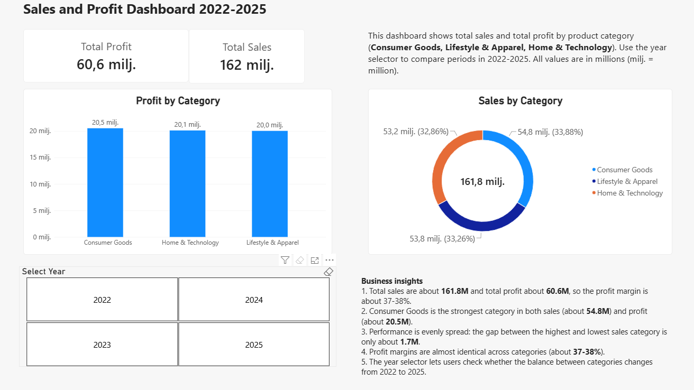

# Power BI Sales Dashboard

A Power BI project that combines two datasets, cleans and models the data, and presents sales and profit by product category in an interactive, accessible dashboard. The project also includes a 10-year profit forecast and a comparison with an AI-generated prediction.

> Course assignment, Laurea University of Applied Sciences (Power BI for Data Visualization and Reporting).

## Contents

- [Overview](#overview)
- [Tools](#tools)
- [Data](#data)
- [Data cleaning (Power Query)](#data-cleaning-power-query)
- [Data model and DAX](#data-model-and-dax)
- [Dashboard](#dashboard)
- [Accessibility](#accessibility)
- [Forecast and AI analysis](#forecast-and-ai-analysis)
- [Repository structure](#repository-structure)
- [Notes and limitations](#notes-and-limitations)

## Overview

The project covers the full workflow from raw data to a finished report:

1. Create a second dataset (Product → Category) and combine it with the sales data.
2. Clean the sales data in Power Query.
3. Build a data model with a relationship between the two tables.
4. Create DAX measures and a monthly sales table by category.
5. Design an interactive dashboard with a focus on accessibility.
6. Forecast profit with Power BI and evaluate an AI prediction critically.

## Tools

- Power BI (Power Query, data model, DAX, report view, forecast)
- Excel (data files and exported tables)
- Claude AI (category dataset, Power Query command, DAX help)
- Google Gemini (predictive analysis)

## Data

| Dataset | Description |
|---|---|
| Sales dataset | Sales transactions for 2022-2025 (original course dataset, not included in this repository) |
| Category dataset | Created for this project, with the columns `Product` and `Category` |

The category dataset groups the six products into three categories. Product names match the sales data exactly.

| Category | Products |
|---|---|
| Consumer Goods | Beauty, Food |
| Lifestyle & Apparel | Clothing, Sports |
| Home & Technology | Electronics, Furniture |

## Data cleaning (Power Query)

Steps performed on the sales data:

- Promoted the first row to headers.
- Removed rows where `Product` was empty (2 rows) by filtering out null values.
- Replaced the date 15.01.2022 with 16.01.2022 in the `Date` column (Replace Values).
- Corrected the misspelling "Beuty" to "Beauty" in the `Product` column (`Table.ReplaceValue`).
- Renamed the column `Discount` to `Discount_Amount` (`Table.RenameColumns`).

Result: the cleaned table has **4,558 rows** and 14 columns.

## Data model and DAX

**Relationship:** `cleaned[Product]` → `Category[Product]`, many-to-one (\*:1), single cross-filter direction, active.

**Measures:**

```dax
Total Sales = SUM(cleaned[Sales])
Total Profit = SUM(cleaned[Profit])
```

**Monthly sales by category** (a helper column is needed first, because `MONTH` cannot be used on a column with many values inside `SUMMARIZE`):

```dax
Month number = MONTH(cleaned[Date])

Monthly Sales by Category =
SUMMARIZECOLUMNS(
    'Category'[Category],
    cleaned[Year],
    cleaned[Month number],
    "Total Sales", [Total Sales]
)
```

The result table has 144 rows (3 categories × 4 years × 12 months).

## Dashboard

A one-page interactive dashboard that uses data from both tables:

- Main title and explanatory text
- Cards for **Total Profit** and **Total Sales** (DAX measures)
- Bar chart: **Profit by Category**
- Donut chart: **Sales by Category**
- Year slicer (2022-2025) that filters all visuals
- Text box with business insights

<!-- Add a screenshot of the dashboard, for example: -->
<!--  -->

### Key insights

| Metric | Value |
|---|---|
| Total sales | about 161.8M |
| Total profit | about 60.6M |
| Profit margin | about 37-38% |

1. Consumer Goods is the strongest category in both sales (about 54.8M) and profit (about 20.5M).
2. Performance is evenly spread: the gap between the highest and lowest sales category is about 1.7M.
3. Profit margins are almost identical across categories (about 37-38%).

## Accessibility

- Clear main title, explanatory text and descriptive visual titles.
- Dark text on a light background for strong contrast and larger font sizes.
- Information does not rely on color alone: data labels show values and percentages.
- Tile (button) slicer with a title instead of a slider, which is easier to use with a keyboard.
- Alternative text added to all data visuals.
- Visuals named in the Selection pane and a logical tab order set (title, explanation, cards, slicer, charts, insights).
- Simple, consistent layout with spacing between visuals.

Limitation: two shades of blue and orange in the donut chart may be hard to separate for some color-blind users, but the labels and legend keep the chart readable.

## Forecast and AI analysis

**Power BI forecast:** a line chart of total profit by year with a 10-year forecast. The forecast rises slowly from about 15.3M (2025) to about 16.5M (2035), which is less than 1% growth per year. The confidence interval widens over time, so the long-term forecast is uncertain.

**AI analysis (Google Gemini):** the AI predicted that Consumer Goods (especially Food) and Beauty will perform best in 2026.

Evaluation:

- The figures the AI used are correct, and Consumer Goods did grow clearly more than the other categories in 2025.
- The AI extends the growth of one year (about 20%) into 2026, which is not consistent with the slow growth in the Power BI forecast.
- The Power BI forecast is for total profit, so it cannot confirm predictions for single categories.
- The dataset covers only four years, and some of the AI's explanations are not visible in the data.
- The response is best used as an idea about where to look, not as a reliable prediction.

## Repository structure

```
.
├── README.md
├── data/
│   ├── powerbi_sales_category.xlsx
│   ├── powerbi_sales_cleaned.xlsx
│   └── monthly_sales_by_category.xlsx
├── images/
│   └── dashboard.png
└── report/
    └── Diary_Report.pdf
```

Adjust the structure to match the files you actually upload (for example the `.pbix` file, if you have one).

## Notes and limitations

- The dataset does not specify a currency, so values are shown in millions without a currency symbol.
- The data covers only four years (2022-2025), so forecasts are rough indications and not exact predictions.
- The original course dataset is not included in this repository.
- AI tools were used as support: Claude AI for the category dataset, a Power Query command and DAX help (Power BI Copilot was not available because of missing permissions), and Google Gemini for the predictive question.

## Author

Nico Soini
